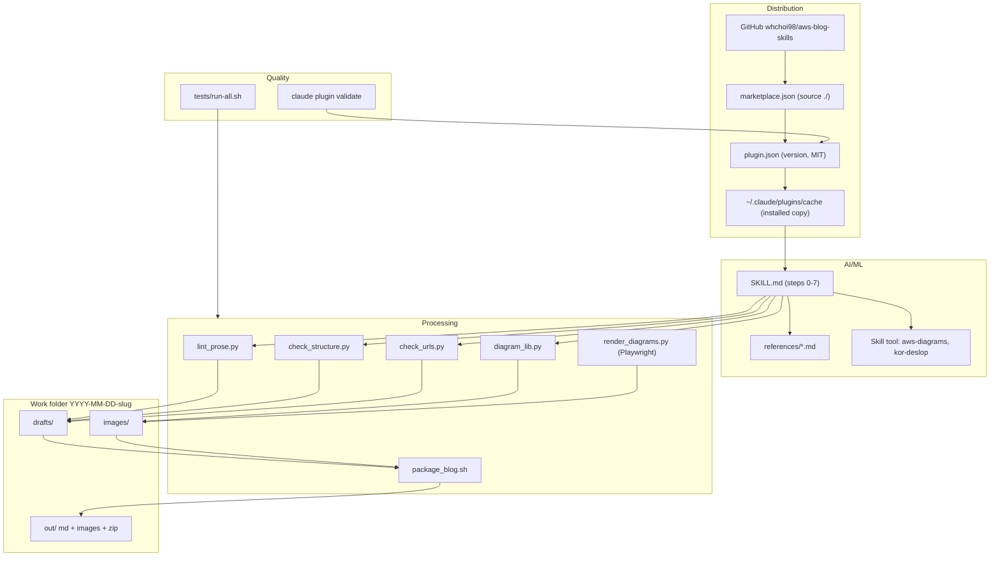
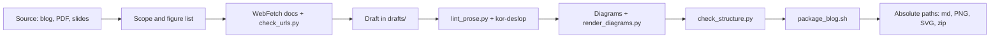

# Architecture

---

# English

## System Overview
`aws-blog-skills` is a Claude Code plugin with one skill that turns source material into a publish-ready Korean
draft for the AWS Korea Tech Blog. The skill is Markdown instructions plus deterministic scripts: Claude reads
SKILL.md and the reference file for each step, and runs the bundled Python and Bash scripts for checks that
must not depend on judgment (banned words, structure, URLs, diagram geometry, packaging). All output goes to a
work folder under the user's current directory.

## Components

### Distribution Layer
- `.claude-plugin/marketplace.json` — single-repo marketplace, plugin `source: "./"`
- `.claude-plugin/plugin.json` — name, version (the update key for installed copies), MIT license
- GitHub `whchoi98/aws-blog-skills` — installers clone it into `~/.claude/plugins/cache/aws-blog-skills/`

### AI/ML Layer
- `skills/aws-blog-skills/SKILL.md` — trigger description, reference table, Claude Code 실행 환경, steps 0-7
- `skills/aws-blog-skills/references/` — structure, style, humanize checklist, verification, diagrams,
  exemplars, collaboration; read on demand
- Delegated skills — `aws-diagrams:aws-diagram`, `aws-diagrams:aws-diagram-design`, `kor-writing:kor-deslop`

### Processing Layer
- `lint_prose.py` — banned words, AI-tell counts, sentences over 120/140 characters
- `check_structure.py` — frontmatter, byline, captions, image paths, author bio
- `check_urls.py` — HTTP 200 and same final URL for every link in a draft
- `diagram_lib.py` + `example_diagrams.py` — SVG canvas with 4px grid and overlap asserts
- `render_diagrams.py` — Playwright render to 2x PNG with font and overflow gates
- `package_blog.sh` — assemble, check, zip, print deliverables

### Security Layer
- `.claude/settings.json` deny list and empty attribution; `.claude/hooks/secret-scan.sh` (PreToolUse, exit 2)
- git `pre-commit` and `commit-msg` hooks from `scripts/install-hooks.sh`
- Scripts write only to the work folder; nothing is written into the plugin cache

### Quality Layer
- `tests/run-all.sh` with hook, secret-pattern, structure and shipped-script suites
- `claude plugin validate .`

## Full Architecture Diagram

## Data Flow Summary

## Packaging

| Path | Ships to installers | Loaded as plugin component | Notes |
|---|---|---|---|
| `.claude-plugin/` | yes | yes | Manifests |
| `skills/aws-blog-skills/` | yes | yes | Skill, references, scripts, template |
| `skills/CLAUDE.md` | yes | no | Module doc, not inside a skill |
| `.mcp.json` | yes | yes | Must stay empty |
| `.claude/` | yes | no | Dev harness, active only in this repo |
| `docs/`, `tests/`, `scripts/` | yes | no | Inert for installers |
| `README.md`, `CHANGELOG.md`, `LICENSE` | yes | no | |

## Key Design Decisions
- **Claude Code only** — SKILL.md uses `${CLAUDE_SKILL_DIR}`, a work folder and Claude Code tools; the claude.ai
  copy is kept apart ([ADR-001](decisions/ADR-001-claude-code-skill-conventions.md)).
- **Check the assembled bundle** — packaging checks exactly what ships in the zip, so image paths cannot pass in
  the draft and break in the bundle.
- **Scripts for mechanical rules** — banned words, structure, URL status and diagram geometry are scripts with
  exit codes; the model keeps judgment calls.
- **Final URL, not just status** — docs.aws.amazon.com redirects missing pages with HTTP 200, so the checker
  compares the final URL.
- **Delegate, don't copy** — diagram and 윤문 rules come from the aws-diagrams and kor-writing skills.

## Operations
- Release: [docs/runbooks/release-plugin.md](runbooks/release-plugin.md)
- Onboarding: [docs/onboarding.md](onboarding.md)

---

# 한국어

## 시스템 개요
`aws-blog-skills`는 소재를 AWS Korea Tech Blog에 게시할 수 있는 한국어 원고로 만드는 skill 하나를 담은 Claude Code 플러그인입니다. skill은 Markdown 지침과 결정적 스크립트로 이루어집니다. Claude는 SKILL.md와 단계별 참조 파일을 읽고, 판단에 맡기면 안 되는 검사(금지어, 구조, URL, 다이어그램 기하, 패키징)는 함께 배포되는 Python과 Bash 스크립트로 실행합니다. 모든 결과는 사용자의 현재 디렉터리 아래 작업 폴더에 만들어집니다.

## 구성 요소

### Distribution Layer
- `.claude-plugin/marketplace.json` — 저장소 하나짜리 마켓플레이스, 플러그인 `source: "./"`
- `.claude-plugin/plugin.json` — 이름, 버전(설치본 갱신 기준), MIT 라이선스
- GitHub `whchoi98/aws-blog-skills` — 설치자가 `~/.claude/plugins/cache/aws-blog-skills/`로 받아 갑니다

### AI/ML Layer
- `skills/aws-blog-skills/SKILL.md` — 트리거 description, 참조 표, Claude Code 실행 환경, 0~7단계
- `skills/aws-blog-skills/references/` — structure, style, humanize checklist, verification, diagrams, exemplars, collaboration. 필요할 때 읽습니다
- 위임하는 skill — `aws-diagrams:aws-diagram`, `aws-diagrams:aws-diagram-design`, `kor-writing:kor-deslop`

### Processing Layer
- `lint_prose.py` — 금지어, AI 티 패턴 횟수, 120자와 140자를 넘는 문장
- `check_structure.py` — 프론트매터, 바이라인, 캡션, 이미지 경로, 저자 소개
- `check_urls.py` — 원고의 모든 링크가 HTTP 200이고 최종 URL이 같은지
- `diagram_lib.py` + `example_diagrams.py` — 4px 그리드와 겹침 assert가 있는 SVG 캔버스
- `render_diagrams.py` — 폰트와 오버플로 게이트를 거친 Playwright 2배율 PNG 렌더
- `package_blog.sh` — 조립, 검사, zip, 결과 경로 출력

### Security Layer
- `.claude/settings.json` deny 목록과 비운 attribution, `.claude/hooks/secret-scan.sh`(PreToolUse, exit 2)
- `scripts/install-hooks.sh`가 설치하는 git `pre-commit`과 `commit-msg` 훅
- 스크립트는 작업 폴더에만 쓰고 플러그인 캐시에는 쓰지 않습니다

### Quality Layer
- 훅, 시크릿 패턴, 구조, 배포 스크립트 테스트를 묶은 `tests/run-all.sh`
- `claude plugin validate .`

## 전체 아키텍처 다이어그램

## 데이터 흐름 요약

## 패키징

| 경로 | 설치자에게 배포 | 플러그인 구성 요소로 로드 | 비고 |
|---|---|---|---|
| `.claude-plugin/` | 예 | 예 | 매니페스트 |
| `skills/aws-blog-skills/` | 예 | 예 | skill, 참조, 스크립트, 템플릿 |
| `skills/CLAUDE.md` | 예 | 아니요 | 모듈 문서, skill 폴더 밖 |
| `.mcp.json` | 예 | 예 | 비워 두어야 함 |
| `.claude/` | 예 | 아니요 | 개발 하네스, 이 저장소에서만 동작 |
| `docs/`, `tests/`, `scripts/` | 예 | 아니요 | 설치자에게는 동작하지 않음 |
| `README.md`, `CHANGELOG.md`, `LICENSE` | 예 | 아니요 | |

## 주요 설계 결정
- **Claude Code 전용** — SKILL.md는 `${CLAUDE_SKILL_DIR}`, 작업 폴더, Claude Code 도구를 씁니다. claude.ai 사본은 따로 둡니다([ADR-001](decisions/ADR-001-claude-code-skill-conventions.md)).
- **조립한 번들을 검사** — 패키징은 zip에 들어갈 것을 그대로 검사하므로, 원고에서는 통과하고 번들에서 깨지는 이미지 경로가 생기지 않습니다.
- **기계적 규칙은 스크립트로** — 금지어, 구조, URL 상태, 다이어그램 기하는 종료 코드가 있는 스크립트로 두고, 모델은 판단만 맡습니다.
- **상태 코드만이 아니라 최종 URL까지** — docs.aws.amazon.com은 없는 페이지를 HTTP 200으로 리디렉션하므로 검사기가 최종 URL을 비교합니다.
- **복사하지 않고 위임** — 다이어그램과 윤문 규칙은 aws-diagrams와 kor-writing skill에서 가져옵니다.

## 운영
- 릴리스: [docs/runbooks/release-plugin.md](runbooks/release-plugin.md)
- 온보딩: [docs/onboarding.md](onboarding.md)
